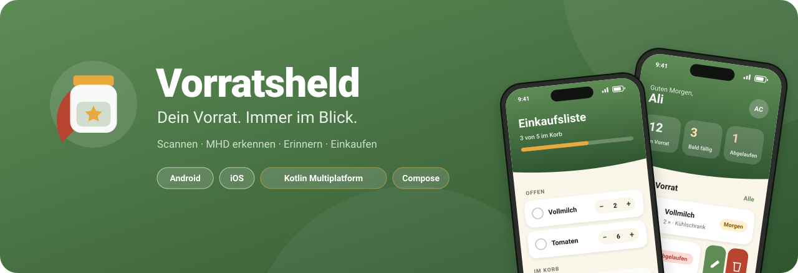
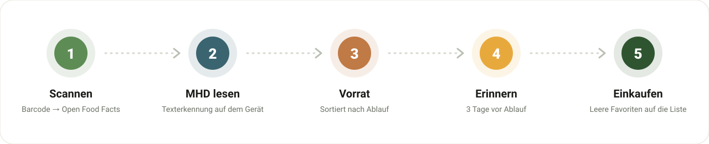
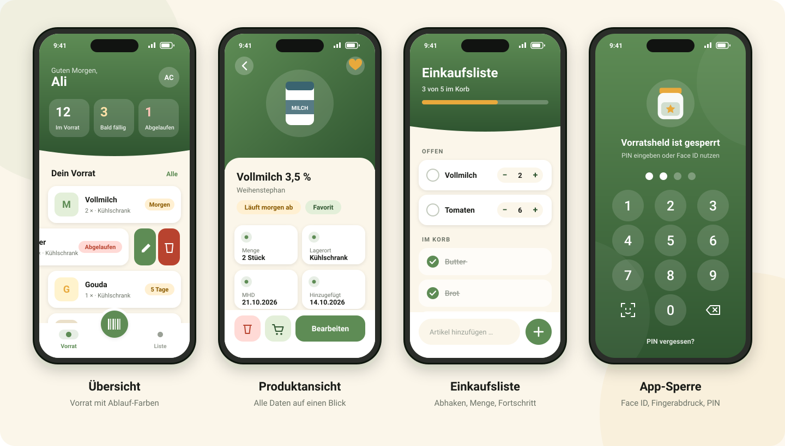
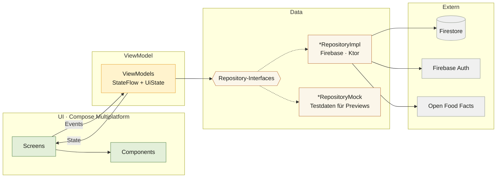

<div align="center">



<br/>


**Eine App, zwei Plattformen: Lebensmittel scannen, Haltbarkeit im Blick behalten und weniger wegwerfen.**

[Funktionen](#funktionen) · [Screens](#screens) · [Architektur](#architektur) · [Tech-Stack](#tech-stack) · [Installation](#installation)

</div>

---

## Die Idee

**Vorratsheld** ist eine Vorrats-App für den eigenen Haushalt. Sie zeigt, was zu Hause ist und was bald abläuft.

Produkte werden per Barcode gescannt. Das Mindesthaltbarkeitsdatum liest die Kamera direkt von der Verpackung ab. Kurz bevor etwas abläuft, kommt eine Erinnerung, und was aufgebraucht ist, landet automatisch auf der Einkaufsliste.

Android und iOS teilen sich **eine gemeinsame Codebasis**: Logik, Daten und Oberfläche sind mit Kotlin Multiplatform und Compose Multiplatform geschrieben. Nur Kamera, Biometrie und Benachrichtigungen sind nativ für die jeweilige Plattform umgesetzt.

## Ablauf



## Funktionen

<table>
<tr>
<td width="50%" valign="top">

### Scannen
- Barcode-Scan mit automatischem Abruf von Name, Marke und Bild über **Open Food Facts**
- **MHD-Erkennung** per Texterkennung direkt auf dem Gerät, ohne Cloud
- Taschenlampe für dunkle Küchen und spiegelnde Verpackungen

</td>
<td width="50%" valign="top">

### Vorrat
- Übersicht mit Ablauf-Farben: frisch, bald fällig, abgelaufen
- Nach links wischen zum **Bearbeiten oder Löschen**, mit Rückgängig-Funktion
- Detailansicht mit Menge, Lagerort, MHD und Favoriten

</td>
</tr>
<tr>
<td width="50%" valign="top">

### Erinnerungen
- Hinweis **3 Tage vor Ablauf**
- Android: täglicher Hintergrund-Check mit WorkManager
- iOS: geplante lokale Benachrichtigungen

</td>
<td width="50%" valign="top">

### Einkaufsliste
- Abhaken, Menge per Stepper, Wischen zum Löschen
- Fortschrittsbalken: wie viel schon im Korb ist
- Aufgebrauchte Favoriten landen automatisch auf der Liste

</td>
</tr>
<tr>
<td width="50%" valign="top">

### Sicherheit
- App-Sperre mit **Face ID, Touch ID oder Fingerabdruck**
- Eigener App-PIN als Ausweichlösung
- Sperrzeit einstellbar: sofort, nach 1 oder 5 Minuten, nur beim Start

</td>
<td width="50%" valign="top">

### Sprachen & Profil
- **10 Sprachen**, direkt in der App umschaltbar
- Animierter Splash-Screen und Onboarding
- Profil mit Foto, Hilfe-Formular, Rechtstexte

</td>
</tr>
</table>

## Screens

<div align="center">

</div>

## Architektur

Die App folgt **MVVM** mit dem **Repository-Pattern**. Jedes Feature hat einen eigenen Ordner mit Screen, ViewModel und UiState. Jedes Repository hat ein Interface und zwei Umsetzungen: eine echte mit Firebase oder API und eine Mock-Version mit Testdaten. Koin verbindet alles. Dadurch laufen alle Compose-Previews ohne Internet und ohne Firebase.



### Plattform-Code mit `expect` / `actual`

| Funktion | Android | iOS |
|---|---|---|
| Kamera | CameraX | AVFoundation |
| Barcode | ML Kit Barcode Scanning | AVFoundation Metadata |
| Texterkennung (MHD) | ML Kit Text Recognition | Apple Vision |
| Biometrie | BiometricPrompt | LocalAuthentication |
| Erinnerungen | WorkManager + Notifications | UserNotifications |
| Lokaler Speicher | SharedPreferences | NSUserDefaults |

## Tech-Stack

| Bereich | Technologie |
|---|---|
| **Sprache** | Kotlin 2.4 (Multiplatform) |
| **UI** | Compose Multiplatform 1.11, Material 3 |
| **Architektur** | MVVM, Repository-Pattern, `StateFlow` |
| **Dependency Injection** | Koin |
| **Navigation** | Navigation Compose mit typsicheren Routen |
| **Backend** | Firebase Auth + Cloud Firestore (GitLive SDK) |
| **Netzwerk** | Ktor Client + kotlinx.serialization |
| **Bilder** | Coil 3, FileKit |
| **Datum** | kotlinx-datetime |

## Projektstruktur

```
Vorratsheld/
├── androidApp/            Android-Einstieg (Activity, Application, Manifest)
├── iosApp/                Xcode-Projekt, Firebase per Swift Package Manager
├── shared/
│   └── src/
│       ├── commonMain/    Gemeinsamer Code für Android und iOS
│       │   ├── data/
│       │   │   ├── enums/        Enums, eine Datei pro Enum
│       │   │   ├── model/        Data Classes, eine Datei pro Model
│       │   │   ├── remote/       APIs, Collection-Namen, DTOs
│       │   │   ├── repository/   Interface · Impl · Mock
│       │   │   └── settings/     Lokale Einstellungen
│       │   ├── di/               Koin-Modul
│       │   ├── platform/         expect-Deklarationen
│       │   ├── ui/
│       │   │   ├── components/   Wiederverwendbare Composables
│       │   │   ├── navigation/   NavGraph und Routen
│       │   │   ├── theme/        Farben, Formen, Schriften
│       │   │   └── <feature>/    Pro Feature Screen, ViewModel, UiState
│       │   │                     (overview, shoppinglist, productinfo, ...)
│       │   └── util/             Helper (Datum, Biometrie, MHD-Parser)
│       ├── androidMain/   actual-Code für Android
│       └── iosMain/       actual-Code für iOS
└── firestore.rules        Sicherheitsregeln für Firestore
```

## Datenschutz & Sicherheit

- **Texterkennung offline:** Fotos der Verpackung verlassen das Gerät nicht.
- **PIN nie im Klartext:** Gespeichert wird nur ein gesalzener SHA-256-Hash.
- **Eigene Daten bleiben privat:** Die Firestore-Regeln erlauben jedem Nutzer nur den Zugriff auf seine eigenen Produkte, Listen und sein Profil.

## Installation

<details>
<summary><b>Voraussetzungen</b></summary>

<br/>

- Android Studio mit dem Kotlin-Multiplatform-Plugin
- Xcode (für iOS, nur auf dem Mac)
- JDK 17 oder neuer
- Ein eigenes Firebase-Projekt

</details>

<details>
<summary><b>Firebase einrichten</b></summary>

<br/>

1. In der [Firebase Console](https://console.firebase.google.com) ein Projekt anlegen
2. Eine Android-App (`com.example.vorratsheld`) hinzufügen und die `google-services.json` nach `androidApp/` legen
3. Eine iOS-App mit derselben Bundle-ID hinzufügen und die `GoogleService-Info.plist` nach `iosApp/iosApp/` legen
4. **Authentication** mit E-Mail/Passwort aktivieren
5. **Firestore** anlegen und die Regeln aus [`firestore.rules`](firestore.rules) veröffentlichen

</details>

<details>
<summary><b>App starten</b></summary>

<br/>

```bash
git clone https://github.com/Ali-C313/Vorratsheld.git
cd Vorratsheld
```

- **Android:** Projekt in Android Studio öffnen, Gradle synchronisieren und die Run-Konfiguration `androidApp` starten
- **iOS:** `iosApp/iosApp.xcodeproj` in Xcode öffnen, unter *Signing* das eigene Team wählen und starten

</details>

<details>
<summary><b>Optional: Support-Mails per EmailJS</b></summary>

<br/>

Anfragen aus dem Hilfe-Formular werden immer in Firestore gespeichert. Damit sie zusätzlich als Mail ankommen, die Zugangsdaten von [emailjs.com](https://www.emailjs.com) in `shared/src/commonMain/kotlin/com/example/vorratsheld/data/remote/EmailJsConfig.kt` eintragen.

</details>

## Roadmap

- [x] Kotlin Multiplatform für Android und iOS
- [x] Barcode- und MHD-Scan mit Taschenlampe
- [x] Einkaufsliste mit Stepper und Wisch-Gesten
- [x] App-Sperre mit Biometrie und PIN
- [x] 10 Sprachen
- [ ] Supabase als alternatives Backend
- [ ] Unit- und UI-Tests
- [ ] Veröffentlichung im Play Store und App Store

## Autor

<table>
<tr>
<td>

**Ali Chehab**<br/>
App-Entwicklung (Android & iOS) · Syntax Institut

[](https://github.com/Ali-C313)

</td>
</tr>
</table>
